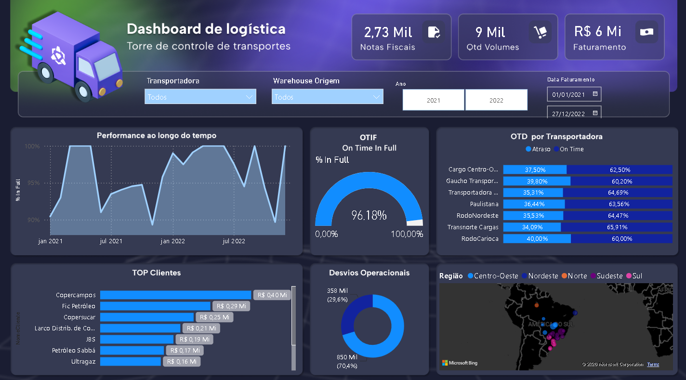

# Caso 02 — Torre de Controle de Transportes: Monitoramento Logístico e OTIF

> **Navegação Interativa (Power BI):** [Acessar Portfólio Publicado](https://app.powerbi.com/view?r=eyJrIjoiN2I2ZDgwYzYtZTRkZC00YTNkLTllNzAtYzg2OTQ5NTRkYjM1IiwidCI6IjVjZWYyNWRiLTAyYmYtNDQ0ZS04YzVkLWI3ZjA0NzZkZTc1NyJ9)

## 1. Contexto e Problema de Negócio
Na operação de distribuição, acompanhar apenas o volume faturado não garante eficiência na ponta. A **Torre de Controle de Transportes** foi estruturada para responder a três perguntas operacionais entre **2021 e 2022**:
1. Qual é o nível real de serviço entregue ao cliente final (**OTIF — On Time In Full**)?
2. Quais transportadoras estão puxando os índices de atraso (**OTD — On Time Delivery**)?
3. Qual o impacto financeiro e volumétrico dos **desvios operacionais** nas entregas e quais clientes concentram maior movimentação?

---

## 2. Origem dos Dados
* **Fonte:** Base operacional de embarques e notas fiscais de transporte (dataset analítico de logística e cadeia de suprimentos cobrindo o período de **01/01/2021 a 27/12/2022**, totalizando `2,73 mil` notas fiscais, `9 mil` volumes transportados e `R$ 6 Mi` em faturamento transportado).
* **Amostra e Dicionário:** Consulte os metadados em [`dados/dicionario_dados.md`](./dados/dicionario_dados.md) e uma amostra dos registros em [`dados/amostra_fentregas.csv`](./dados/amostra_fentregas.csv).

---

## 3. Tratamento e Preparação dos Dados (Power Query / ETL)
* **Padronização de datas e status de entrega:** Tratamento das datas de faturamento, previsão de entrega e entrega efetiva para classificar cada nota fiscal como *On Time* ou *Atraso*.
* **Categorização de ocorrências:** Agrupamento de ocorrências de transporte para separar entregas regulares de **Desvios Operacionais**.
* **Padronização geográfica e de parceiros:** Normalização dos nomes das transportadoras, *Warehouses* de origem, clientes embarcadores e macrorregiões (*Centro-Oeste, Nordeste, Norte, Sudeste e Sul*).
* **Documentação completa:** Veja o detalhamento das regras em [`documentacao/etl_regras_sla.md`](./documentacao/etl_regras_sla.md).

---

## 4. Modelagem Dimensional (Star Schema)
O modelo segue o padrão **Star Schema**, centralizando os registros de notas fiscais/embarques na tabela fato (`fEntregas`) e conectando-a às dimensões operacionais (`dCalendario`, `dTransportadora`, `dWarehouse` e `dCliente`).

* **Tabela Fato (`fEntregas`):** Granularidade por Nota Fiscal emitida (`2,73 mil` NFs, `9 mil` volumes e `R$ 6 Mi` transportados).
* **Diagrama e Regras:** Acesse [`modelagem/star_schema.md`](./modelagem/star_schema.md).

---

## 5. Consultas SQL & Medidas DAX
* **Consultas SQL:** Queries de cálculo de OTD por transportadora, OTIF consolidado e desvios por região em [`sql/indicadores_otif.sql`](./sql/indicadores_otif.sql).
* **Medidas DAX:** Fórmulas de SLA (`% On Time`, `% In Full`, `OTIF %`) e volumetria em [`dax/medidas_logisticas.dax`](./dax/medidas_logisticas.dax).

---

## 6. Principais Achados e Insights

* **Alto índice de completude (OTIF), mas gargalo relevante em pontualidade (OTD):** O indicador **OTIF (% In Full)** consolidado atingiu **96,18%** (mostrando que a carga chega completa na grande maioria dos casos), porém o detalhamento de **OTD por Transportadora** revela taxas de atraso entre **34% e 40%** em praticamente toda a malha (ex.: *RodoCarioca* com `40,00%` de atraso e *Gaúcha Transportes* com `39,80%`), indicando necessidade imediata de revisão de prazos (SLAs) ou penalidades contratuais.
* **Quase 30% de desvios operacionais:** Do volume analisado, **29,6%** (`358 mil`) apresentaram algum tipo de desvio operacional frente a **70,4%** (`850 mil`) dentro da normalidade — um ponto crítico de custo oculto e retrabalho na operação.
* **Instabilidade mensal de performance:** A série histórica de 2021 a 2022 mostra quedas bruscas de performance em períodos específicos (como meados de 2021, virada para 2022 e segundo semestre de 2022), sugerindo forte impacto sazonal ou picos de demanda sem absorção proporcional pela frota.
* **Concentração em grandes contas:** O ranking de **TOP Clientes** é liderado por *Copercampos* (`R$ 0,40 Mi`), *Pic Petróleo* (`R$ 0,29 Mi`) e *Copersucar* (`R$ 0,25 Mi`), permitindo priorizar planos de ação logísticos nas contas de maior impacto financeiro.

---

## 7. Visão do Dashboard

---

## 8. Artefatos Técnicos do Projeto
* [`dados/amostra_fentregas.csv`](./dados/amostra_fentregas.csv) — Amostra da tabela fato de entregas
* [`dados/dicionario_dados.md`](./dados/dicionario_dados.md) — Dicionário de dados logísticos
* [`modelagem/star_schema.md`](./modelagem/star_schema.md) — Diagrama e regras do Star Schema
* [`sql/indicadores_otif.sql`](./sql/indicadores_otif.sql) — Consultas SQL de OTIF, OTD e desvios
* [`dax/medidas_logisticas.dax`](./dax/medidas_logisticas.dax) — Medidas DAX de SLA logístico
* [`documentacao/etl_regras_sla.md`](./documentacao/etl_regras_sla.md) — Documentação de ETL e regras de SLA
